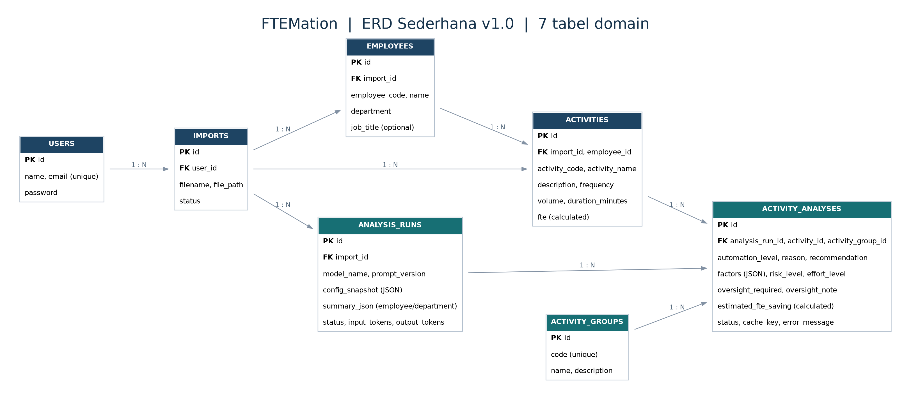

# PRODUCT REQUIREMENTS DOCUMENT (PRD)

## FTEMation

**AI-Powered Workload & Automation Intelligence**  
*From Workload Data to Automation Decisions.*

| Metadata | Detail |
|---|---|
| Versi dokumen | 1.1 — Revisi arsitektur React + REST API + Vanilla CSS |
| Tanggal | 11 November 2026 |
| Status | Siap untuk implementasi MVP; detail kecil diverifikasi saat coding |
| Produk | FTEMation |
| Platform | Aplikasi web lokal dengan opsi deployment online |
| Acuan utama | `Studi Kasus AI Insight.pdf` (Tancorp) |
| Repository rencana | `ftemation` |
| Catatan | Dataset bersifat sintetis; bukan data internal Tancorp |

> **Prinsip proyek:** penuhi seluruh ketentuan assessment lebih dahulu. Keunggulan AI engineering harus terlihat dari hasil yang terstruktur, dapat dievaluasi, dapat ditelusuri, dan tidak menghitung FTE menggunakan LLM.

> **Revisi v1.1:** dokumen ini menggantikan PRD v1.0 khususnya pada arsitektur frontend dan komunikasi. Stack terkunci: Laravel 13 + PHP 8.4, React + TypeScript + Vite, Vanilla CSS, REST API + Axios + React Router, Sanctum cookie-based SPA auth, MySQL, DeepSeek Flash, PhpSpreadsheet, DomPDF. **Jangan menggunakan Inertia.js, Mantine, CSS Modules, Bootstrap, atau Tailwind.** Untuk keputusan terakhir lihat `TECH_STACK_DECISIONS_v1.1.md`.


## 1. Ringkasan produk

FTEMation adalah aplikasi Laravel 13 dengan antarmuka React untuk mengimpor data aktivitas karyawan, menghitung beban kerja dalam satuan **Full-Time Equivalent (FTE)**, menggunakan DeepSeek Flash untuk menilai potensi otomatisasi, mengelompokkan proses serupa lintas departemen, lalu menampilkan rekomendasi tindakan dan laporan.

**Masalah:** data aktivitas kerja belum langsung menjawab aktivitas mana yang layak diotomasi, berapa kapasitas waktu kerja yang mungkin dihemat, dan proses mana yang harus diprioritaskan.

**Solusi:** satu alur *import → validasi → FTE → AI assessment → grouping → agregasi → insight → export* dengan hasil yang tersimpan di database.

### 1.1 Tujuan produk

1. Menghasilkan seluruh fitur dan berkas yang secara eksplisit diwajibkan PDF assessment.
2. Menunjukkan AI application engineering: prompt versioning, JSON validation, retry, cache, serta evaluasi klasifikasi dan grouping.
3. Menghasilkan estimasi efisiensi yang transparan dan bisa dihitung ulang tanpa memanggil LLM.
4. Menyediakan pengalaman demo yang cepat: reviewer login dan langsung melihat hasil analisis yang telah disimpan.

### 1.2 Pengguna dan hak akses

| Aktor | Kebutuhan | Cakupan MVP |
|---|---|---|
| Admin / Demo User | Login, import Excel, jalankan AI, tinjau analisis, dashboard, export | Satu peran login sederhana |
| Reviewer HR | Memahami beban kerja, prioritas, dan ringkasan departemen | Mengakses melalui akun demo |
| Reviewer IT | Menilai struktur, reliability, prompt, perhitungan, dan testing | Source code, README, demo, ERD |

**Di luar cakupan:** multi-role permission yang kompleks, SSO, integrasi ERP/HRIS/WMS sungguhan, training model, dan manajemen data personal produksi.

## 2. Ruang lingkup dan prioritas

| Prioritas | Fitur | Dasar |
|---|---|---|
| P0 — Wajib | Login dan akun demo dalam README | PDF assessment |
| P0 — Wajib | Import Excel dengan validasi | PDF assessment |
| P0 — Wajib | AI: high/medium/low, alasan dan rekomendasi | PDF assessment |
| P0 — Wajib | Kesimpulan AI per karyawan dan departemen; saving dan prioritas | PDF assessment |
| P0 — Wajib | Dashboard total FTE, potensi, departemen, detail aktivitas | PDF assessment |
| P0 — Wajib | Grouping aktivitas serupa lintas karyawan/departemen dan total FTE | PDF assessment |
| P0 — Wajib | Export PDF, Excel, `results.json` dari aplikasi | PDF assessment |
| P0 — Wajib | Retry, penanganan API gagal, cache, prompt terpisah, README asumsi | PDF assessment |
| P1 — Kualitas | Audit faktor AI, risiko, effort, metadata dan metrik evaluasi | Keputusan FTEMation |
| P1 — Pembeda | Opportunity Radar (ranking transparan) | Keputusan FTEMation; boleh sederhana |
| P2 — Opsional | What-If Simulator menggunakan slider baseline | Keputusan FTEMation |
| P3 — Ditunda | Flutter, ROI finansial, advanced multi-user, embeddings mandiri | Bukan persyaratan wajib |

**Aturan prioritas:** P1/P2 tidak boleh menunda kelengkapan P0 dan pengumpulan akhir.

## 3. Dataset, entitas, dan aturan input

Dataset rujukan: `samples/FTEMation_Workload_Dataset_v1.xlsx`, worksheet `Workload`, **60 aktivitas, 12 karyawan, 3 departemen**, masing-masing karyawan memiliki lima aktivitas. Data sintetis berbasis proses manufaktur dan distribusi FMCG; pemimpin departemen menggunakan jabatan simulasi CFO, CHRO, dan COO. Lima aktivitas hanya mewakili sebagian tugas karyawan.

### 3.1 Skema input Excel (tepat sembilan kolom)

| Kolom | Tipe logis | Ketentuan |
|---|---|---|
| `activity_id` | string | Wajib, unik per import |
| `employee_id` | string | Wajib; seorang karyawan konsisten nama/departemennya |
| `employee_name` | string | Wajib |
| `department` | string | Wajib, dinormalisasi secara konsisten |
| `activity_name` | string | Wajib |
| `description` | text | Wajib, memuat proses dan konteks kerja |
| `frequency` | enum | `daily`, `weekly`, `monthly` |
| `volume` | numeric positif | Unit aktivitas per periode |
| `duration_minutes` | numeric positif | Menit per satu unit aktivitas |

**Ketentuan acceptance dataset pengumpulan:** minimal 50 aktivitas, 10 karyawan, tiga departemen, dan beberapa aktivitas serupa untuk uji grouping. **Kebijakan aplikasi:** tidak harus menolak workbook kecil yang valid untuk testing, tetapi menunjukkan peringatan jika belum memenuhi ukuran minimum assessment.

**Aturan import:** validasi header, nilai kosong, ID ganda, relasi karyawan yang tidak konsisten, angka bukan numerik/negatif, frekuensi invalid; tampilkan alasan dan nomor baris. Import gagal tidak boleh meninggalkan data setengah tersimpan. Simpan file asli secara privat, batasi ukuran unggahan (usulan 5 MB), dan catat status import. Dataset evaluasi AI **tidak** diimpor ke tabel Workload.

### 3.2 Dataset evaluasi (pendukung, bukan input inferensi)

`samples/FTEMation_AI_Evaluation_v1.xlsx`: 15 label referensi awal (5 high, 5 medium, 5 low), 16 pasangan grouping, dan 20 kategori. Label awal adalah referensi peninjauan manual—**bukan akurasi model atau ground truth teruji**. Koreksi pasangan ambigu sebelum menghitung metrik evaluasi final.

## 4. Alur pengguna (user journey)

1. User masuk menggunakan akun demo.
2. Halaman dashboard menampilkan dataset demo yang telah dianalisis bila tersedia, disertai status/versi hasil.
3. User dapat mengunggah Excel baru dan melihat ringkasan validasi/hasil import.
4. User menjalankan AI assessment, memantau jumlah `pending`, `processing`, `success`, dan `failed`.
5. Setelah selesai, user melihat aktivitas dan alasan AI, rangkuman karyawan/departemen, serta grouping.
6. User melihat prioritas otomatisasi; opsional mengubah slider saving pada What-If.
7. User mengekspor laporan PDF, Excel, dan `results.json` dari analisis yang lengkap.

## 5. Functional requirements dan acceptance criteria

### FR-01 — Login demo (P0)

- Akun demo disediakan oleh seeder dan kredensial dicantumkan dalam README.
- Halaman selain login hanya bisa diakses setelah autentikasi.
- Logout mengakhiri sesi; password disimpan sebagai hash.
- **Lulus jika:** kredensial demo dapat login/logout dan halaman terlindungi menolak pengguna yang belum login.

### FR-02 — Import dan validasi Excel (P0)

- Unggah `.xlsx` pada halaman Imports; gunakan satu sheet `Workload` dan sembilan kolom wajib.
- Preview jumlah aktivitas, karyawan, departemen, serta daftar error per baris bila gagal.
- Simpan `imports`, `employees`, `activities` secara atomik; impor yang sama dapat dibuat sebagai riwayat baru tanpa merusak data lama.
- **Lulus jika:** file utama menjadi 60 aktivitas, 12 karyawan, tiga departemen tanpa duplikasi di dalam import; input invalid ditolak informatif.

### FR-03 — FTE calculator (P0)

- Laravel menghitung FTE dari angka dataset; AI tidak menerima mandat menentukan angka FTE.
- Simpan nilai presisi tinggi; gunakan nilai belum dibulatkan untuk agregasi.
- **Lulus jika:** ACT-0001 (10 unit/hari × 9 menit) = 0,1875 FTE; total dataset referensi = 4,4671875 FTE.

### FR-04 — AI Activity Assessment (P0)

- DeepSeek Flash menilai lima faktor dan mengembalikan `automation_level`, `reason`, `recommendation`, `group_id`, risk/effort, dan kebutuhan human oversight.
- Gunakan prompt terpisah dan versi prompt, JSON mode, serta validasi semua enum/field Laravel.
- Start 5 aktivitas per batch; konfigurasi batch dan `max_tokens` diuji berdasarkan output nyata.
- **Lulus jika:** 60 aktivitas menghasilkan 60 hasil tervalidasi, atau kegagalan diberi status jelas dan dapat di-retry.

### FR-05 — Reliability dan cache (P0)

- Queue database untuk proses analisis, timeout, retry terbatas pada error sementara, serta status per aktivitas.
- Cache/reuse hanya untuk konten relevan yang sama, model, versi rubrik/prompt, dan taksonomi sama.
- Jangan menampilkan hasil palsu sebagai sukses saat API gagal; catat error tanpa menyimpan API key.
- **Lulus jika:** timeout/JSON invalid tidak menjadi `success`; analisis ulang input identik tidak mengirim request AI ulang.

### FR-06 — Kesimpulan AI per karyawan dan departemen (P0)

- Laravel mengagregasi FTE/saving dan prioritas; AI membuat narasi ringkas berdasarkan angka agregat yang diberikan.
- Ringkasan mencakup 12 karyawan dan 3 departemen (untuk dataset demo), opsi prioritas teratas, dan catatan bahwa saving bersifat estimasi.
- Kesimpulan disimpan per analysis run dalam `summary_json` dan hanya dianggap final jika tersedia lengkap.
- **Lulus jika:** setiap karyawan/departemen memiliki ringkasan, nilai agregat cocok dengan aktivitas, dan tidak ada angka LLM yang menggantikan perhitungan program.

### FR-07 — Dashboard dan detail (P0)

- KPI: total FTE, estimated FTE saving, distribusi High/Medium/Low, dan progres analisis.
- Perbandingan tiga departemen, tabel aktivitas dengan pencarian/filter, tampilan reason/recommendation.
- Tampilkan perbedaan beban kerja tercatat dan total kapasitas karyawan.
- **Lulus jika:** KPI konsisten dengan data import/run terpilih dan pengguna dapat menelusuri KPI ke daftar aktivitas.

### FR-08 — Grouping lintas departemen (P0)

- AI memilih tepat satu `group_id` dari 20 taksonomi tetap untuk setiap aktivitas.
- Tampilan group menampilkan jumlah anggota, departemen unik, total FTE, dan total saving.
- Level otomatisasi dalam group boleh berbeda; tidak ada double counting.
- **Lulus jika:** terdapat kelompok beranggotakan aktivitas lintas departemen, total FTE group = jumlah FTE anggota.

### FR-09 — Export laporan (P0)

- Export PDF ringkasan dashboard, departemen, karyawan, prioritas, dan metode FTE.
- Export Excel berisi aktivitas dan hasil analisis yang tervalidasi.
- Export `results.json` berisi seluruh aktivitas dan semua field minimum PDF.
- **Lulus jika:** ketiga export dihasilkan melalui aplikasi dari satu analysis run lengkap dan angka antarformat konsisten.

### FR-10 — Automation Opportunity Radar (P1)

- Ranking berdasarkan saving, risk, effort dengan skor eksplisit (bagian 7).
- Tampilan berupa tabel ranking yang dapat dibaca; grafik tambahan hanya jika waktu cukup.
- **Lulus jika:** ranking dapat dihitung ulang secara deterministik dan penjelasan faktor skor terlihat.

### FR-11 — What-If Simulator (P2)

- Slider mengubah asumsi saving High/Medium/Low di UI tanpa panggilan AI dan tanpa mengubah baseline.
- **Lulus jika:** hasil simulasi berubah seketika, sementara export baseline dan database tidak berubah.

## 6. Aturan AI: rubrik, human oversight, grouping

### 6.1 Lima faktor dan output AI

| Faktor | Nilai | Interpretasi |
|---|---|---|
| Repetitiveness | low / medium / high | Seberapa berulang prosesnya |
| Rule clarity | low / medium / high | Kejelasan aturan dan pengecualian |
| Data structure | low / medium / high | Keteraturan input/output |
| Human judgment | low / medium / high | Besarnya kebutuhan keputusan manusia |
| Operational risk | low / medium / high | Konsekuensi kesalahan proses |

AI menilai lima faktor secara kualitatif lalu menentukan level. Laravel memastikan skema dan konsistensi yang dapat diperiksa, **bukan mengeklaim memverifikasi kebenaran semantik secara otomatis**.

| Level | Definisi keputusan |
|---|---|
| High | Mayoritas langkah layak diotomasi; keputusan sensitif tetap diawasi |
| Medium | Sebagian langkah layak diotomasi; review/penanganan exception signifikan |
| Low | Inti aktivitas membutuhkan judgment atau keputusan manusia; AI hanya membantu tugas pendukung |

**Kebijakan oversight:** aktivitas dengan keputusan final berisiko tinggi harus menyertakan human oversight. Output yang mengusulkan pengambilalihan keputusan final tanpa kontrol ditandai untuk koreksi/review, bukan diterima begitu saja. High-risk tidak otomatis menjadikan semua tugas administratif Low.

### 6.2 Taksonomi grouping (20 kategori)

`structured_record_entry`, `rule_based_validation`, `periodic_reporting`, `standard_followup`, `exception_investigation`, `data_reconciliation`, `human_negotiation`, `assisted_classification`, `contextual_analysis`, `complex_accounting_adjustment`, `supervisory_approval`, `kpi_monitoring`, `planning_forecasting`, `scheduling_coordination`, `high_impact_decision`, `master_data_update`, `templated_document`, `routine_qa_response`, `human_interview`, `quotation_comparison`.

Aturan: kategori berdasarkan **mekanisme pekerjaan dominan**; bukan sekadar nama mirip, departemen sama, atau level otomasi sama. Group dengan satu anggota tetap valid. Output di luar taksonomi ditolak. Penilaian kesamaan referensi diuji menggunakan pasangan positif dan negatif pada dataset evaluasi.

## 7. Perhitungan FTE, saving, dan prioritas

### 7.1 Asumsi baseline (keputusan FTEMation, bukan standar wajib PDF)

| Parameter | Nilai |
|---|---:|
| Hari efektif kerja | 240 per tahun |
| Jam efektif per hari | 8 |
| Kapasitas tahunan | 115.200 menit/FTE |
| Faktor daily | 240 |
| Faktor weekly | 48 |
| Faktor monthly | 12 |
| Saving High | 60% |
| Saving Medium | 30% |
| Saving Low | 10% |

**Rumus:** `annual_minutes = volume × duration_minutes × annual_factor`; `fte = annual_minutes / 115200`; `estimated_fte_saving = fte × saving_rate`; `remaining_fte = fte - estimated_fte_saving`.

**Contoh:** ACT-0001, daily × 10 × 9 menit → `21.600 / 115.200 = 0,1875 FTE`. Jika level hasil AI adalah High, estimasi saving baseline `0,1875 × 0,60 = 0,1125 FTE`, sisa `0,0750 FTE`. Level contoh ini bersifat ilustratif/referensi, bukan hasil API yang sudah dijalankan.

**Prinsip interpretasi:** estimated saving = kapasitas waktu berpotensi dibebaskan, **bukan jumlah karyawan yang pasti dikurangi**. Karena lima aktivitas per karyawan hanya cuplikan, total dataset tidak boleh dipakai untuk klaim produktivitas individu secara utuh.

### 7.2 Precision

Simpan FTE dan saving dengan ketelitian internal setidaknya delapan desimal, agregasi memakai nilai belum dibulatkan; dashboard menampilkan empat desimal, export angka sampai enam desimal. Konfigurasi baseline berada di `config/ftemation.php`; snapshot tiap run di `analysis_runs.config_snapshot`.

### 7.3 Opportunity priority (P1)

`priority_score = 100 × (saving_i / max_saving_run) × risk_factor × effort_factor` (jika max saving = 0, skor 0).

| Level | Risk factor | Effort factor |
|---|---:|---:|
| Low | 1,00 | 1,00 |
| Medium | 0,70 | 0,75 |
| High | 0,40 | 0,50 |

Skor relatif 0–100 untuk mengurutkan peluang pada **analysis run yang sama**, bukan probabilitas kesuksesan, dan bukan persetujuan mengotomasi keputusan berisiko tinggi. Laravel menghitung skor, DeepSeek hanya memberi penilaian kualitatif.

## 8. Arsitektur sistem dan stack

| Layer | Teknologi / keputusan |
|---|---|
| Backend | Laravel 13, PHP 8.4 terdeteksi di perangkat development |
| Frontend | React + TypeScript + Vite + React Router |
| UI styling | Vanilla CSS; tanpa Tailwind, Mantine, Bootstrap, CSS Modules |
| Database | MySQL 8 (satu database aplikasi) |
| AI | DeepSeek API, model alias `deepseek-flash`, mode non-thinking awal |
| Queue / Cache | Database queue dan database cache Laravel |
| Excel | PhpSpreadsheet (versi yang kompatibel dengan PHP 8.4/Laravel 13) |
| PDF export | DomPDF (pilih rilis yang kompatibel dengan Laravel 13 dan PHP 8.4) |
| API / Auth | REST JSON API; Laravel Sanctum SPA cookie/session + CSRF, Axios; akun demo |
| Storage | Excel privat; export dihasilkan berdasarkan data tersimpan |

**Pola deployment:** satu repository dengan Laravel di root dan React SPA di `frontend/`; komunikasi melalui REST API. Gunakan React Router, Axios, dan Sanctum SPA cookie/session dengan CSRF; saat production, build React disajikan dari origin Laravel yang sama agar hosting tetap sederhana. Tidak ada microservice atau kebutuhan deploy frontend tersendiri. Online hanya jika hosting mendukung PHP, MySQL, dan queue worker; jalur lokal wajib stabil.

**Lingkungan developer yang telah terdeteksi:** PHP 8.4.26, Composer 2.9.8, Node 24.15, npm 11.12, Git tersedia. Docker tidak terdeteksi dari Git Bash; Docker bukan blocker. PHP CLI saat pengecekan berasal dari folder runtime proyek lain, sehingga `php --ini`, `where.exe php`, dan koneksi MySQL perlu diverifikasi sebelum install.

## 9. ERD sederhana: tujuh tabel domain



| Tabel | Data utama | Catatan |
|---|---|---|
| `users` | id, name, email, password | Login demo |
| `imports` | id, user_id, filename, file_path, status | Satu import = satu dataset/version |
| `employees` | id, import_id, employee_code, name, department, job_title? | `job_title` opsional dari seeder; tidak ada di Excel |
| `activities` | id, import_id, employee_id, activity_code, name, description, frequency, volume, duration_minutes, fte | Data mentah dan FTE Laravel |
| `analysis_runs` | id, import_id, model_name, prompt_version, config_snapshot, summary_json, status, input_tokens, output_tokens | Riwayat proses dan kesimpulan |
| `activity_groups` | id, code, name, description | 20 kategori tetap di-seed |
| `activity_analyses` | id, run_id, activity_id, group_id, automation_level, reason, recommendation, factors JSON, risk, effort, oversight, saving, status, cache_key, error | Hasil AI + Laravel |

**Unique constraint:** `(import_id, employee_code)`, `(import_id, activity_code)`, `(analysis_run_id, activity_id)`, dan `activity_groups.code`. Foreign key sesuai gambar. Gunakan transaksi database untuk import; gunakan *restrict* atau cascade secara terencana agar hasil run tidak kehilangan konsistensi.

**Tabel infrastruktur Laravel** (`jobs`, `failed_jobs`, `cache`, sesi jika digunakan) tidak dihitung sebagai tujuh tabel domain. Tidak diperlukan tabel `departments` atau tabel khusus kesimpulan pada MVP; departemen di `employees`, ringkasan dalam `analysis_runs.summary_json`.

### 9.1 Status & versioning

- Import: `pending` → `imported` / `failed`.
- Run: `queued` → `processing` → `completed` / `partial_failed` / `failed`.
- Analysis: `pending` → `processing` → `success` / `failed`.
- Export resmi dari `completed` yang memuat satu hasil sukses untuk setiap aktivitas pada import itu dan ringkasan karyawan/departemen selesai.
- Cache fingerprint mencakup atribut yang dikirim ke AI (nama, deskripsi, konteks departemen, frekuensi/volume bila digunakan), nama model, versi prompt, rubrik, dan taksonomi; perubahan perhitungan FTE saja tidak perlu menjalankan AI ulang.
- Jika hasil cached disalin ke run lain, hitung ulang saving dari FTE dan konfigurasi run baru; jangan menyalin ID aktivitas atau saving lama secara buta.

## 10. Kontrak hasil AI dan export

### 10.1 Respons internal DeepSeek (contoh, bukan output aktual)

```json
{
  "activity_id": "ACT-0001",
  "automation_level": "high",
  "group_id": "structured_record_entry",
  "factors": {
    "repetitiveness": "high",
    "rule_clarity": "high",
    "data_structure": "high",
    "human_judgment": "low",
    "operational_risk": "medium"
  },
  "implementation_effort": "medium",
  "automation_scope": "majority_steps",
  "human_oversight_required": true,
  "oversight_note": "Manusia memeriksa invoice pengecualian.",
  "reason": "Input terstruktur dan berulang.",
  "recommendation": "Ekstraksi dokumen dan integrasi ERP dengan exception review."
}
```

Validasi enum, `group_id` harus dikenal, `activity_id` harus ada di batch, alasan/rekomendasi tidak kosong, oversight note wajib jika oversight diperlukan. Simpan hanya hasil tervalidasi; jika batch JSON gagal, tangani tanpa menggandakan hasil sukses yang sudah tersimpan.

### 10.2 `results.json` wajib dari aplikasi (contoh satu item)

```json
{
  "activities": [
    {
      "activity_id": "ACT-0001",
      "automation_level": "high",
      "reason": "Input data manual berulang.",
      "recommendation": "OCR dan integrasi ERP.",
      "group_id": "structured_record_entry",
      "fte": 0.1875,
      "estimated_fte_saving": 0.1125,
      "status": "success"
    }
  ]
}
```

Dalam file final, array `activities` wajib berisi **seluruh 60 aktivitas dataset pengumpulan**, bukan hanya satu contoh. `fte` dan `estimated_fte_saving` dihitung oleh Laravel; `group_id` memakai kode taksonomi, bukan ID integer. Contoh di PRD bukan data hasil DeepSeek.

## 11. Halaman aplikasi dan UX minimum

| Halaman | Komponen utama | Prioritas |
|---|---|---|
| Login | Form email/password, identitas FTEMation | P0 |
| Dashboard | KPI FTE/saving/status, grafik departemen, ringkasan utama | P0 |
| Imports | Upload, history, validasi baris, ringkasan dataset | P0 |
| AI Analyses | Tombol jalankan, progres, retry failed, versi model | P0 |
| Activity Details | Filter, level, faktor, alasan, rekomendasi, group | P0 |
| Employee & Department Insights | Total FTE, saving, AI summary, prioritas | P0 |
| Activity Groups | Kelompok lintas departemen, total FTE, saving | P0 |
| Reports / Export | Unduh PDF, Excel, JSON | P0 |
| Opportunity Radar | Ranking dengan faktor skor | P1 |
| What-If | Slider High/Medium/Low, hasil skenario sementara | P2 |

Desain: bersih, ringan, enterprise/modern SaaS; warna netral + aksen teal/biru; aksesibel (label, status jelas, kontras memadai), state loading/empty/error dan responsif desktop. Reviewer harus dapat menggunakan data demo tersimpan tanpa menunggu 60 request baru.

## 12. Non-functional requirements

| Area | Persyaratan dan verifikasi |
|---|---|
| Reliability | Timeout, retry/backoff untuk 429/5xx/timeouts; error permanen tidak di-loop |
| Consistency | Satu hasil analisis sukses per activity/run; satu FTE tidak dihitung ganda |
| Security | Auth middleware; validasi upload; file privat; API key `.env`; tidak commit secret; escaping output |
| Performance | Dashboard membaca database, bukan AI; loading/progres saat queue bekerja |
| Explainability | Tampilkan 5 faktor, level, risk, effort, rekomendasi, oversight |
| Auditability | Simpan model alias, prompt version, snapshot asumsi, token bila tersedia |
| Cost control | Batch kecil, cache, non-thinking awal, catat input/output tokens; cegah rerun otomatis |
| Portability | README langkah install untuk Windows dan kredensial demo; mode lokal prioritas |
| Accuracy | Unit test perhitungan, evaluasi 15 referensi dan 16 pasangan; hasil evaluasi dilaporkan apa adanya |

**Catatan batas JSON mode:** valid JSON tidak selalu berarti memenuhi schema bisnis; konten kosong, terpotong, maupun enum tidak valid harus dianggap gagal. Kualitas interpretasi manusia tidak dijamin oleh JSON validation.

## 13. Rencana pengujian dan kriteria rilis

| ID | Skenario | Kriteria lulus |
|---|---|---|
| T01 | Login/logout demo | Bekerja; halaman privat terlindungi |
| T02 | Excel 60 aktivitas | Masuk utuh: 60/12/3 |
| T03 | Excel header salah/duplikat/angka invalid | Ditolak dengan error spesifik |
| T04 | FTE daily, weekly, monthly | Cocok dengan kalkulasi referensi |
| T05 | FTE total dataset demo | `4.4671875` sebelum pembulatan |
| T06 | Respons AI JSON valid | Tersimpan dengan 5 faktor dan 20 grup valid |
| T07 | Respons kosong/invalid atau API timeout | Status gagal/ retry terbatas, bukan sukses palsu |
| T08 | Input dan versi sama | Hasil cache dipakai, API tidak dipanggil lagi |
| T09 | Group lintas departemen | Total FTE group = jumlah anggota, tanpa duplikasi |
| T10 | Summary karyawan/departemen | Lengkap; angka sesuai agregasi Laravel |
| T11 | Dashboard dan tiga export | Angka sama dengan analysis run yang dipilih |
| T12 | `results.json` final | 60 aktivitas, field wajib lengkap, semua status success |
| T13 | Evaluasi model | Metrik dihitung dan dilaporkan, tanpa mengarang akurasi |
| T14 | Simulator (jika P2) | Mengubah skenario, bukan hasil baseline |

**Exit criteria P0:** semua T01–T12 lulus pada dataset final, README dapat diikuti pada lingkungan bersih, dan video menunjukkan alur lengkap. T13 adalah pembeda kualitas yang dikerjakan setelah pipeline P0 stabil; T14 opsional.

## 14. Urutan implementasi / milestone

| Tahap | Pekerjaan | Output yang harus terbukti |
|---|---|---|
| 1 — Foundation | Laravel 13 REST API, React + TypeScript + Vanilla CSS, MySQL, Sanctum SPA auth, migration, seeder | Login dan data schema berfungsi |
| 2 — Workload | Excel import, validasi, FTE service, unit test | 60/12/3, total FTE cocok |
| 3 — AI Engine | DeepSeek smoke test, rubrik/prompt, jobs, cache, validasi JSON, grouping | 60 hasil tervalidasi, retry dan cache demonstrable |
| 4 — Insights | Summary employee/department, dashboard, group, priority | KPI dan narasi terhubung ke data tersimpan |
| 5 — Delivery | PDF/Excel/JSON, README, ERD final, test, ZIP, video, Drive | Seluruh file terbuka dan dapat didemokan |
| Stretch | What-If, UI polish, deployment online | Hanya setelah deliverables aman |

Assessment diberikan dengan jendela pengerjaan **tiga hari sejak 10 November 2026**; waktu/jam tenggat final harus mengikuti komunikasi HR, bukan diasumsikan otomatis. Fokus pada jalur lokal yang pasti berfungsi sebelum deployment online.

## 15. Deliverables wajib dan Definition of Done

| File | Kriteria selesai |
|---|---|
| Source code ZIP + README | Dependency, setup, env example, queue, cara run, akun demo, AI model, rubrik, FTE, saving |
| Dataset Excel | `samples/FTEMation_Workload_Dataset_v1.xlsx` yang benar-benar dipakai untuk import |
| ERD PNG/PDF | Sesuai migration database yang dijalankan; bukan diagram rencana yang sudah usang |
| Video dengan suara | 8–10 menit, memperlihatkan login → import → AI → dashboard/grouping → export |
| `results.json` | Benar-benar diekspor oleh aplikasi dari run lengkap, bukan diketik manual |
| Google Drive folder | Satu folder, `Anyone with the link – Viewer`, diuji dari akun/incognito lain |

**Definition of Done:** fitur P0 diuji pada data final, angka FTE dapat direproduksi, output AI tervalidasi, failure dan cache diperlihatkan, dan semua artefak terkumpul serta bisa diakses reviewer.

## 16. Risiko, keputusan terbuka, dan mitigasi

| Risiko / keputusan | Mitigasi praktis |
|---|---|
| API DeepSeek tidak tersedia / saldo habis | Hasil demo dari run nyata tersimpan; status kegagalan jelas; retry hanya seperlunya |
| Output grup/level tidak konsisten | Rubrik tetap, 20 grup dikontrol, evaluation set, versioned cache |
| Waktu UI habis | Prioritaskan tabel/KPI fungsional dan export daripada animasi atau Flutter |
| Online deployment tidak mendukung queue | Mode lokal sebagai jalur utama; deployment online stretch |
| PHP CLI mengarah ke folder proyek lain | Konfirmasi path, php.ini, ekstensi, MySQL sebelum setup Laravel |
| Kesimpulan AI mengarang angka | Angka disuplai Laravel; validasi/rekonsiliasi terhadap data agregasi |
| Label evaluasi ambigu | Review manual sebelum hitung metrik; catat mismatch |
| Kredensial/API bocor | `.gitignore`, `.env.example`, private repository selama development |

**Keputusan teknis yang tinggal diuji saat coding:** koneksi MySQL dan path PHP; permintaan pertama ke `deepseek-flash`; pustaka PDF kompatibel; pengaturan worker queue lokal/hosting. Hal-hal ini **bukan alasan menunda** pembuatan project Laravel dan migration.

## 17. Sumber dan batas klaim

1. **Sumber utama (wajib):** `Studi Kasus AI Insight.pdf`, satu halaman, diberikan dalam assessment Tancorp. Seluruh item P0 berasal dari bagian Tugas, Ketentuan Dataset, Ketentuan Teknis, Contoh Format `results.json`, dan Yang Dikumpulkan.
2. **Artefak proyek:** `samples/FTEMation_Workload_Dataset_v1.xlsx`, `samples/FTEMation_AI_Evaluation_v1.xlsx`, `docs/DATASET_GUIDE.md`, dan `docs/ERD_v1.mmd`.
3. **Referensi implementasi (dicek 11 Nov 2026):** Laravel 13 — <https://laravel.com/docs/13.x>; PhpSpreadsheet — <https://phpspreadsheet.readthedocs.io/>; Laravel Sanctum 13.x — <https://laravel.com/docs/13.x/sanctum>; DeepSeek JSON Mode — <https://api-docs.deepseek.com/guides/json_mode/>; DeepSeek Thinking Mode — <https://api-docs.deepseek.com/guides/thinking_mode/>.

**Perbedaan sumber vs asumsi:** PDF tidak menentukan jumlah tabel, React, DeepSeek, bobot prioritas, 240 hari kerja, ataupun saving 60/30/10. Semua itu adalah keputusan desain FTEMation dan harus dipresentasikan sebagai **asumsi proyek**, bukan persyaratan perusahaan atau hasil yang sudah terbukti secara empiris.
